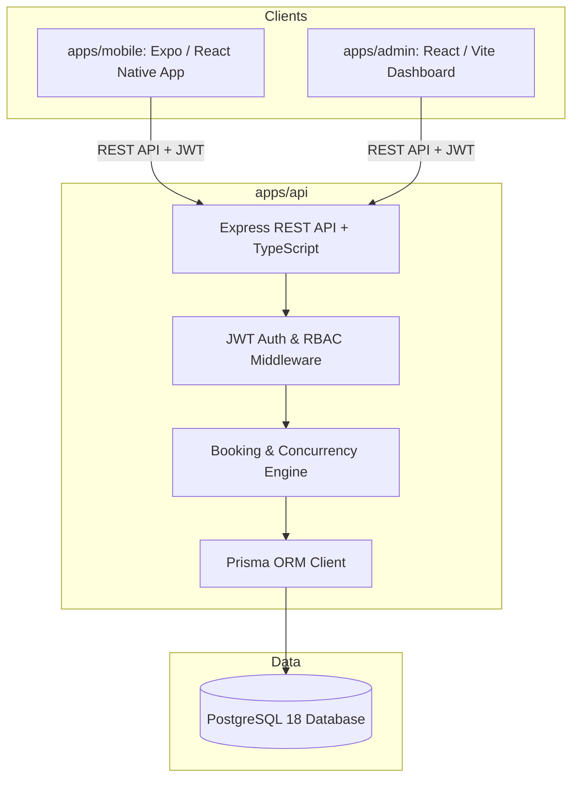

# Chairly — Architecture & Implementation Plan

## 1. System Overview & Architecture

Chairly is a full-stack, multi-tenant barbershop booking platform comprising:
- **`apps/api`**: Node.js + Express + TypeScript + Prisma ORM REST backend with PostgreSQL.
- **`apps/admin`**: Staff/owner web dashboard built with React (Vite), TypeScript, Tailwind CSS, and Lucide icons.
- **`apps/mobile`**: Customer-facing mobile application built with React Native (Expo SDK 52/53 with Expo Router), TypeScript, and custom premium UI components.
- **`packages/shared`**: Shared TypeScript types, Zod schemas, booking validation logic, and constants (e.g., status enums, role definitions).



---

## 2. Monorepo Structure

```text
chairly/
├── package.json                   # Monorepo root (npm workspaces)
├── tsconfig.base.json             # Shared TS configurations
├── packages/
│   └── shared/                    # Types, validation schemas (Zod), DTOs
│       ├── package.json
│       ├── tsconfig.json
│       └── src/
│           ├── types/             # User, Shop, Barber, Service, Appointment
│           ├── schemas/           # Auth, Booking, Service, Schedule schemas
│           └── constants/         # Roles, Statuses, Currency defaults
├── apps/
│   ├── api/                       # Express REST API
│   │   ├── package.json
│   │   ├── prisma/
│   │   │   ├── schema.prisma      # Normalized DB models
│   │   │   ├── migrations/
│   │   │   └── seed.ts            # Realistic seed data (3 shops, barbers, bookings)
│   │   └── src/
│   │       ├── config/            # Env config, DB connection, JWT secrets
│   │       ├── middlewares/       # Auth (JWT), RBAC, shop isolation, validation
│   │       ├── routes/            # Auth, Shops, Services, Barbers, Availability, Bookings, Dashboard
│   │       ├── controllers/
│   │       ├── services/          # Concurrency-safe booking engine, slot calculator
│   │       └── utils/             # Date/timezone handlers (Asia/Tashkent default)
│   ├── admin/                     # Staff web application
│   │   ├── package.json
│   │   ├── vite.config.ts
│   │   ├── tailwind.config.js
│   │   └── src/
│   │       ├── components/        # Shell, Sidebar, Calendar, DataTable, Modals
│   │       ├── pages/             # Dashboard, Calendar, Services, Staff, Customers, Settings
│   │       ├── hooks/             # API data fetching, auth context
│   │       └── services/          # API client
│   └── mobile/                    # Customer Expo mobile app
│       ├── package.json
│       ├── app.json
│       ├── app/                   # Expo Router file-based routing
│       │   ├── (auth)/            # Sign in, Sign up, Welcome
│       │   ├── (tabs)/            # Home, Explore, Appointments, Profile
│       │   ├── shop/[id].tsx      # Barbershop detail & gallery
│       │   ├── booking/           # Step-by-step booking flow
│       │   └── appointment/[id]   # Details, reschedule, cancellation
│       └── src/
│           ├── components/        # Themed UI kit (buttons, cards, time slots)
│           ├── context/           # Auth session persistence, Favorites
│           └── services/          # Mobile API client
```

---

## 3. Database Schema (PostgreSQL + Prisma)

### Core Models & Relationships

1. **`User`**:
   - `id`, `email`, `phone`, `passwordHash`, `firstName`, `lastName`, `avatarUrl`, `isSuperAdmin`, `createdAt`, `updatedAt`
2. **`Shop`**:
   - `id`, `name`, `slug`, `description`, `phone`, `address`, `city`, `logoUrl`, `coverImageUrl`, `timezone` (default `"Asia/Tashkent"`), `currency` (default `"UZS"`), `leadTimeMinutes`, `horizonDays`, `cancelDeadlineHours`, `isActive`, `createdAt`, `updatedAt`
3. **`ShopMember`** (Staff & Permissions):
   - `id`, `shopId`, `userId`, `role` (`OWNER`, `MANAGER`, `BARBER`), `createdAt`
   - Multi-tenant shop-level isolation: a user can be owner of Shop A and customer in Shop B.
4. **`BarberProfile`**:
   - `id`, `shopId`, `userId` (optional link to staff user), `name`, `bio`, `avatarUrl`, `isActive`, `createdAt`
5. **`Service`**:
   - `id`, `shopId`, `name`, `description`, `price` (Int/Decimal in currency units), `durationMinutes`, `bufferMinutes`, `isActive`, `createdAt`, `updatedAt`
6. **`BarberService`** (Many-to-Many):
   - `barberId`, `serviceId`
7. **`ShopWorkingHour`**:
   - `id`, `shopId`, `dayOfWeek` (0-6), `openTime` ("09:00"), `closeTime` ("20:00"), `isClosed`
8. **`BarberSchedule`**:
   - `id`, `barberId`, `dayOfWeek` (0-6), `startTime` ("09:00"), `endTime` ("18:00"), `isWorking`
9. **`BarberBreak`** & **`ShopBlockedTime`**:
   - Break intervals and special dates off / holidays / vacation periods.
10. **`Appointment`** (Double-Booking Protected & Immutable Historical Snapshot):
    - `id`, `bookingReference` (e.g. `CH-8921`), `shopId`, `barberId`, `customerId`, `serviceId`,
    - **Historical Snapshot Fields**: `serviceName`, `servicePrice`, `serviceDuration`, `bufferMinutes` (preserved even if the service is later modified or deleted),
    - `status` (`PENDING`, `CONFIRMED`, `CHECKED_IN`, `IN_PROGRESS`, `COMPLETED`, `CANCELLED`, `NO_SHOW`),
    - `startTime` (Timestamptz), `endTime` (Timestamptz), `bufferEndTime` (Timestamptz),
    - `notes`, `cancelledAt`, `cancellationReason`, `createdAt`, `updatedAt`
11. **`Favorite`**:
    - `id`, `userId`, `shopId`
12. **`AuditLog` / `StatusHistory`**:
    - Tracks appointment transitions with timestamp and actor ID.

---

## 4. Concurrency Protection & Overlap Prevention

To prevent double-booking under race conditions:
1. **Database-Level Advisory Locks / Transaction Isolation**:
   - When attempting to book, the booking service opens a PostgreSQL transaction.
   - It acquires an exclusive lock on the barber's booking window (`SELECT ... FOR UPDATE` or `pg_advisory_xact_lock(barber_id_hash, date_bucket)`).
2. **Strict Non-Overlapping Verification**:
   - Queries existing active appointments (`CONFIRMED`, `PENDING`, `CHECKED_IN`, `IN_PROGRESS`) where:
     `existing.startTime < new.bufferEndTime AND existing.bufferEndTime > new.startTime`.
   - If an overlap exists, transaction aborts and returns HTTP 409 Conflict with fresh availability slots.
3. **Double Reservation Prevention**:
   - Both start and end buffer boundaries are respected.
   - Status transition policy: completed/cancelled appointments no longer block availability, but cannot be resurrected into active state without availability checks.

---

## 5. Security & Multi-Shop Authorization Architecture

1. **Authentication**:
   - Passwords hashed with `bcryptjs` (salt rounds 10).
   - Short-lived Access Tokens (JWT) + Refresh Tokens stored in HTTP-only cookies / secure headers.
   - Mobile: Secure token storage using Expo SecureStore / AsyncStorage fallback.
2. **Shop Isolation Middleware**:
   - Admin routes inspect `:shopId` in URL or request context.
   - Verifies authenticated user's `ShopMember` record for that specific shop.
   - Strictly rejects attempts to view or modify bookings/services/staff belonging to other shops (`HTTP 403 Forbidden`).
3. **Input Validation**:
   - 100% of request bodies and query parameters validated with Zod schemas.
   - Sensitive fields (passwords, tokens) excluded from all responses and logs.

---

## 6. Implementation Milestones

### Milestone 1: Monorepo Foundation & Database (Phase 2)
- Monorepo setup (`package.json`, workspaces for `apps/*`, `packages/*`).
- `packages/shared`: Shared types, Zod schemas, constants.
- `apps/api`: Express, Prisma ORM, PostgreSQL connection.
- Prisma migration & seed script with 3 realistic barbershops in Tashkent (Chop-Chop Tashkent, The Barber Club, Amir Temur Grooming Lounge), diverse barbers, services, schedules, and active bookings.
- Verification: Database seeded, backend health check and test queries working.

### Milestone 2: Core API & Booking Engine (Phase 3)
- Authentication API (Register, Login, Me, Refresh, Logout).
- Public Discovery API (Shops search, details, services, barbers).
- Availability Calculator API: Dynamic slot calculation based on duration, buffer, schedules, breaks, and existing appointments.
- Booking API with PostgreSQL transaction locking and conflict prevention.
- Appointment Management API (reschedule, cancel, update status).
- Automated tests verifying booking concurrency, availability calculations, and shop isolation.

### Milestone 3: Admin Web Application (Phase 4)
- React + Vite + Tailwind CSS setup with Chairly brand tokens (warm off-white `#FBF9F5`, charcoal `#1A1A1A`, terracotta accent `#C25E3E`).
- Auth flow (Login, role enforcement, shop selector).
- Dashboard: Real DB statistics (today's bookings, revenue from completed appointments, active barbers, upcoming schedule).
- Calendar & Appointment List (daily, weekly, filter by barber/status, new manual booking modal).
- Staff & Barber Management (profiles, assigned services, schedules, breaks).
- Services & Pricing Management.
- Shop Settings (opening hours, timezone, booking rules).

### Milestone 4: Customer Mobile Application (Phase 5)
- React Native + Expo + Expo Router setup.
- Brand styling, custom UI primitives (Typography, Card, Badge, TimeSlotPicker, DatePicker).
- Discovery & Search Screen (Categories, featured barbershops, search with filters).
- Shop Details Screen (Photo gallery, services, barbers, hours, location).
- Step-by-step Booking Flow (Service -> Barber -> Date -> Available Slot -> Summary -> Confirmation).
- Appointments Screen (Upcoming, Past, Cancelled, Reschedule & Cancel actions).
- Customer Profile, Favorites, and Persistent Auth.

### Milestone 5: End-to-End Integration, Testing & Verification (Phase 6)
- Test end-to-end customer booking flow reflected live on admin calendar.
- Verify status changes, cancellation, rescheduling, and slot reopening.
- Cross-shop isolation tests (staff of Shop A cannot access Shop B).
- Full automated test suite execution (API tests, booking engine unit tests).
- Monorepo build and lint verification.
- Complete documentation in `README.md` with startup commands and demo credentials.
